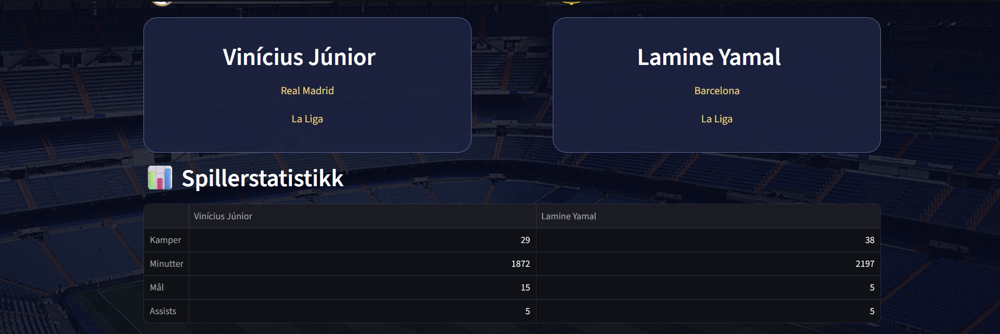

# ⚽ FootballVersus

**FootballVersus** is an interactive football player comparison application built with Python and Streamlit.

The application uses real football statistics from API-Football to compare players through visual dashboards, statistics tables, and interactive charts.

## 📸 Application Screenshots

### ⚽ Player Comparison


### 📊 Player Statistics



### 📈 Goals and Assists Comparison


## 🚀 Features

- Compare football players side by side
- Retrieve real statistics using API-Football
- Display player portraits and club logos
- Compare appearances, minutes, goals, and assists
- Visualize player performance with interactive charts
- Football-inspired interface featuring Santiago Bernabéu

## 🛠️ Technologies

- **Python** – Application development
- **Streamlit** – Interactive web interface
- **API-Football** – Football statistics
- **pandas** – Data processing
- **Altair** – Data visualization
- **Requests** – API integration
- **Git & GitHub** – Version control

## 📊 Data

The application currently uses league statistics from the **2023/24 season**.

Available players include Vinícius Júnior, Kylian Mbappé, Jude Bellingham, Lamine Yamal, Erling Haaland, and Pedri.

## ⚙️ Installation

Clone the repository:

```bash
git clone https://github.com/adankhalid0/FootballVersus.git
cd FootballVersus
```

Create a virtual environment:

```bash
python -m venv .venv
```

Activate it in Git Bash on Windows:

```bash
source .venv/Scripts/activate
```

Install dependencies:

```bash
pip install streamlit requests pandas altair
```

Create `.streamlit/secrets.toml` and configure your API-Football key:

```toml
API_FOOTBALL_KEY = "YOUR_API_KEY_HERE"
```

Run the application:

```bash
streamlit run app.py
```

**Security:** Never commit your real API key. The `.gitignore` file excludes `.streamlit/secrets.toml`.

## 🔮 Future Improvements

- Support more players and leagues
- Add more advanced statistics
- Implement automated testing and GitHub Actions
- Deploy the application online

## 👨‍💻 Author

**Khalid Adan**

GitHub: [@adankhalid0](https://github.com/adankhalid0)

---

*Built with Python, Streamlit, and a passion for football.*